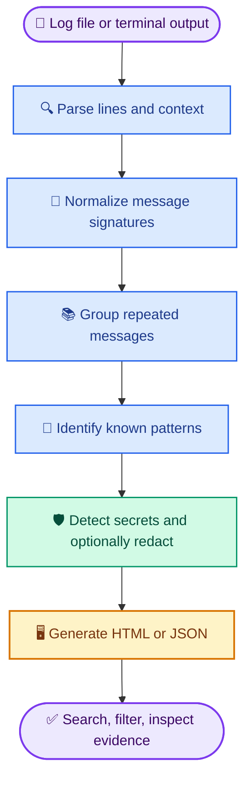

# Logloom

<p align="center">
  
  
</p>

<p align="center">
  <strong>Turn terminal chaos into a debugging report.</strong><br>
  Find the useful errors. Group the noise. Inspect everything in one clean report.
</p>

<p align="center">
  <a href="LICENSE"></a>
  
  
  
  
</p>

Logloom is a local-first command-line tool that turns noisy terminal output, build logs, and test failures into searchable, standalone HTML reports. It groups repeated messages, preserves the original evidence, and helps you review possible secrets before sharing a report.

## ✨ What Logloom does

| | Feature | Why it helps |
|:--:|---|---|
| 🔎 | **Find errors faster** | Recognizes selected severity labels and common failure patterns. |
| 🧩 | **Group repeated messages** | Reduces duplicate noise while preserving original line references. |
| 📊 | **Readable HTML report** | Search, filter, and inspect findings in a browser. |
| 🛡️ | **Secret detection and redaction** | Detects selected secret patterns and can redact detected values. |
| 🔌 | **Pipeline-friendly CLI** | Accepts log files or terminal output through standard input. |
| 📦 | **JSON output** | Makes findings easier to use in scripts and other tools. |

**Built around three principles:** local processing, evidence you can inspect, and honest limits. Pattern matches are clues—not guaranteed root causes.

## 🚀 Quick start

**You need:** Python 3.9 or newer.

The Python project is currently inside the repository's `logloom/` subdirectory. Open PowerShell or a terminal and run:

### Windows

```powershell
git clone https://github.com/Lidnas/Logloom.git
cd Logloom\logloom
py -m pip install -e .
```

Now analyze a log file:

```powershell
logloom analyze examples\failed-build.log --output report.html
```

Or analyze terminal output and redact detected secrets:

```powershell
Get-Content examples\failed-build.log | logloom analyze - --redact
```

### Linux

```bash
git clone https://github.com/Lidnas/Logloom.git
cd Logloom/logloom
python3 -m pip install -e .
logloom analyze examples/failed-build.log --output report.html
```

Then open `report.html` in your browser. It is a local HTML file; you do not need an account or hosted service to inspect it.

## 🧪 Useful commands

<details>
<summary><strong>Analyze a log file</strong></summary>

```bash
logloom analyze build.log --output report.html
```

Creates an HTML report at `report.html`.

</details>

<details>
<summary><strong>Analyze output from another command</strong></summary>

```bash
pytest 2>&1 | logloom analyze -
```

Passes terminal output directly into Logloom.

</details>

<details>
<summary><strong>Generate JSON</strong></summary>

```bash
logloom analyze build.log --format json --output report.json
```

Useful when another script needs to process the output.

</details>

<details>
<summary><strong>Redact detected secrets</strong></summary>

```bash
logloom analyze build.log --redact --output report.html
```

Replaces values detected by the supported redaction patterns in the generated report.

</details>

<details>
<summary><strong>See every CLI option</strong></summary>

```bash
logloom analyze --help
```

| Option | Purpose |
|---|---|
| `--output FILE` | Choose the report path. |
| `--format html|json` | Select HTML or JSON output. |
| `--redact` | Redact values matching supported secret patterns in the report. |
| `--no-raw` | Omit the raw-output section from the HTML report. |
| `--min-severity LEVEL` | Set the minimum displayed severity. |
| `--fail-on never|warning|error` | Return a non-zero exit status when the selected threshold is met. |
| `--title TEXT` | Set the report title. |
| `--quiet` | Suppress the CLI summary. |

</details>

## 🗺️ How it works



Logloom helps you find relevant evidence faster; it does not decide the root cause for you. Similar messages can have different causes, and the first error is not always the underlying cause.

## 🔐 Privacy and security

Logs can contain API keys, access tokens, internal hostnames, usernames, file paths, and other sensitive data.

- **Local processing:** logs are analyzed on your machine.
- **Redaction is optional:** without `--redact`, the report may contain original secret values.
- **Detection is not perfect:** supported patterns may miss credentials or flag harmless text.
- **Review before sharing:** a clean scan does not prove a report is safe to publish.
- **Treat logs as untrusted input:** log content should never be treated as executable instructions.

**Tip:** use `--redact` for reports you plan to share, then inspect the report manually anyway.

## 📈 Performance and tests

The current development snapshot has **158 automated tests passing**. Tests cover parsing, signature grouping, pattern detection, redaction, report generation, CLI behavior, and documentation consistency.

A development benchmark on a 100,000-line log reported approximately **3.6 seconds** for parsing, analysis, secret detection, and report rendering. Results vary by hardware, input, and report size; this is a reference measurement, not a performance guarantee.

Run the tests from the project directory:

```bash
python -m unittest discover
```

## 🤝 Contributing

Logloom is an early-stage open-source developer tool. Helpful contributions include:

- Small, sanitized log examples with expected findings.
- Parser improvements for build tools and test runners.
- Cross-platform bug reports.
- Security tests for HTML rendering and redaction.
- Documentation and usability improvements.

When reporting a bug, include the smallest sanitized input that reproduces it. **Never post production logs, credentials, or private data in a public issue.**

## 📄 License

Released under the [MIT License](LICENSE).

<p align="center">
  <strong>Less noise. Clearer failures. Faster debugging.</strong>
</p>
