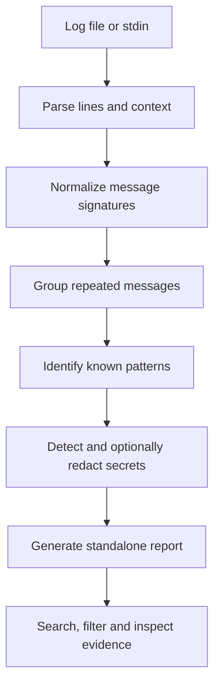

# Logloom

**Turn terminal chaos into a debugging report.**

Logloom is a local-first command-line tool that turns noisy terminal output, build logs, and test failures into searchable, standalone HTML reports. It groups repeated messages, preserves the original evidence, and helps you review possible secrets before sharing a report.

- **Local-first:** your logs are analyzed on your machine.
- **Lightweight:** Python standard library only; no runtime dependencies.
- **Cross-platform:** designed for Windows and Linux.
- **Evidence-led:** findings link back to original log lines. Pattern matches are clues, not guaranteed root causes.

## Quick start

Requires Python 3.11 or newer.

### Run from a source checkout

Clone the repository, then run these commands from its directory:

```powershell
# Analyze a sample log and create an HTML report
py -m logloom analyze examples\failed-tests.log --output report.html

# Analyze piped output and redact detected secrets in the report
Get-Content examples\failed-build.log | py -m logloom analyze - --redact

# Run the test suite
py -m unittest discover
```

On Linux, the equivalent commands use `python3` and a shell pipe:

```bash
python3 -m logloom analyze examples/failed-tests.log --output report.html
cat examples/failed-build.log | python3 -m logloom analyze - --redact
python3 -m unittest discover
```

Open `report.html` in your browser. The report is standalone and can be viewed locally without a hosted service.

## What it does

### Find the signal in noisy logs

- Parses terminal output and recognizes common severity markers.
- Normalizes variable parts of messages to group likely duplicates.
- Recognizes selected patterns from common build tools and test runners.
- Coalesces closely related pattern-matched findings to reduce clutter.
- Preserves original line numbers and surrounding context for verification.
- Handles malformed or unexpected lines defensively.

### Inspect findings in an HTML report

- Search and filter the report.
- Expand findings to inspect matching output and context.
- Review original log lines rather than relying on a generated summary alone.
- Use the report locally; JavaScript enhances interactions, while the report content remains readable without it.

### Review secrets before sharing

Log files may contain credentials, tokens, internal URLs, email addresses, and other private data. Logloom can detect selected secret patterns and redact detected values when requested.

**Important:** without `--redact`, the report may contain original secrets. Detection is heuristic: a clean scan does not prove that a log is safe to share. Always inspect the report before publishing or sending it to someone else.

```powershell
Get-Content build.log | py -m logloom analyze - --redact
```

Use `--redact` whenever you want the generated report to scrub values detected by the redaction rules. It cannot guarantee detection of every secret or every custom credential format.

## CLI examples

Analyze a file:

```bash
logloom analyze build.log --output report.html
```

Analyze piped output:

```bash
pytest 2>&1 | logloom analyze -
```

Generate JSON for downstream tooling:

```bash
logloom analyze build.log --format json
```

Redact detected secrets in a report:

```bash
logloom analyze build.log --redact --output report.html
```

For the full list of options, run:

```bash
logloom analyze --help
```

If running from the source checkout before installing the package, use `py -m logloom` on Windows or `python3 -m logloom` on Linux.

## How it works



Logloom is intended to help you find useful evidence faster, not to decide the root cause for you. Similar messages can have different causes, and the earliest error is not necessarily the cause of the failure.

## Performance and testing

The project has **158 automated tests passing** in the current development snapshot. The test suite covers parsing, grouping, pattern detection, redaction, report generation, CLI behavior, and documentation checks.

A development benchmark on a 100,000-line log reported approximately **3.6 seconds total** across parsing, analysis, secret detection, and rendering. Actual performance depends on log contents, hardware, and the report being generated; treat this as a reference measurement, not a universal guarantee.

Run the test suite locally:

```bash
python -m unittest discover
```

## Security and privacy

- Log processing is local; no cloud account or AI API is required.
- Log content is untrusted input and must be treated carefully.
- Reports generated without `--redact` can contain original sensitive values.
- Secret detection can miss credentials and may occasionally flag harmless text.
- Review reports before sharing them, even after redaction.

If you discover a security issue, avoid posting real credentials or sensitive logs in a public issue. Contact the maintainer privately.

## Project status

Logloom is an early-stage open-source project. Pattern coverage and output formats will evolve as it is tested against more real-world logs. The current goal is a dependable, transparent debugging aid—not automatic root-cause analysis.

Useful contributions include:

- Minimal, sanitized log fixtures with expected findings.
- Parser improvements for build tools and test runners.
- Cross-platform bug reports.
- Security testing for HTML rendering and redaction.
- Documentation and usability improvements.

When reporting a bug, include the smallest sanitized input that reproduces it. **Never attach production logs or credentials without removing sensitive data first.**

## License

Logloom is released under the [MIT License](LICENSE).
