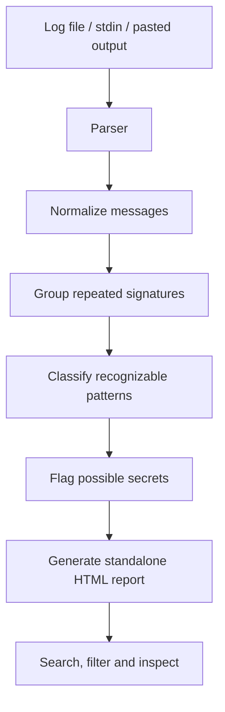

import pypandoc
from pathlib import Path

readme = r'''<div align="center">

# Logloom

### Turn terminal chaos into a debugging report.

A privacy-first, cross-platform CLI concept for turning noisy terminal output, build logs, and test failures into clean, searchable HTML reports.

<p>
  <strong>Local-first</strong> · <strong>Python</strong> · <strong>Windows + Linux</strong> · <strong>Open source</strong>
</p>

<!-- Replace these placeholders after publishing the repository. -->
<p>
  <a href="LICENSE"></a>
  
  
  
</p>

<!-- Replace this with a real screenshot or GIF once the application exists. -->
**A preview of the intended workflow**

```text
 noisy terminal output
          │
          ▼
   ┌───────────────┐
   │    Logloom    │
   │ parse + group │
   │ inspect risks │
   └───────┬───────┘
           │
           ▼
  standalone HTML report
  ┌────────────────────────────┐
  │  Errors found          12  │
  │  Warnings              28  │
  │  Repeated groups        7  │
  │                            │
  │  [Search] [Severity ▾]     │
  │                            │
  │  ERROR  Missing module     │
  │         build.js:42        │
  │  WARN   Deprecated option  │
  │         config.py:18       │
  └────────────────────────────┘
```

<sub>Concept illustration only. It is not a screenshot of a released implementation.</sub>

</div>

---

## The problem

A failed build can produce thousands of lines of output. The important error may be buried beneath repeated warnings, stack traces, dependency messages, and unrelated noise.

Logloom is designed to make that output easier to investigate. It organizes recognizable patterns, groups repeated messages, preserves references to the original lines, and presents the result in a standalone HTML report.

**The goal is not to replace debugging. It is to make the evidence easier to find.**

## What Logloom aims to do

| Capability | Purpose |
|---|---|
| **Log import** | Read log files or accept output through standard input (`stdin`). |
| **Noise reduction** | Identify repeated messages and common log patterns. |
| **Failure grouping** | Group similar messages using normalized signatures. |
| **Interactive report** | Search, filter, expand, and inspect findings in a browser. |
| **Evidence preservation** | Keep original messages and line references available for verification. |
| **Privacy checks** | Flag possible secrets so they can be reviewed before a report is shared. |
| **Cross-platform CLI** | Target Windows and Linux without requiring a hosted service. |

> **Important:** Logloom should distinguish observed facts from heuristics. A first error is not automatically the root cause, and a detected pattern is not proof that two failures have the same cause.

## How it is intended to work



1. **Ingest** — Read the supplied log without executing the commands that produced it.
2. **Parse** — Identify lines, timestamps, severity labels, and recognizable stack traces where possible.
3. **Normalize** — Standardize variable portions of messages to find likely duplicates.
4. **Group** — Present repeated signatures with counts and links to original line numbers.
5. **Review** — Flag potential secrets for explicit inspection and redaction.
6. **Report** — Generate a portable HTML file that can be opened locally.

The report should escape untrusted log content before rendering it. Log files can contain arbitrary text, including HTML and script-like content.

## Example workflow

The commands below describe the planned interface; they will work only once the corresponding CLI commands have been implemented and packaged.

```bash
# Analyze a log file
logloom analyze build.log --output report.html

# Read terminal output from another command
pytest 2>&1 | logloom analyze -

# Request machine-readable output (planned)
logloom analyze build.log --format json
```

Open `report.html` in a browser to inspect the grouped messages and search for relevant errors.

### Example report

A report might organize the input into sections like these:

| Finding | Count | What you can inspect |
|---|---:|---|
| Missing dependency | 8 | Matching messages and original line references |
| Test assertion failure | 4 | Test output and nearby context |
| Deprecation warning | 16 | Repeated warning instances |
| Potential secret | 1 | Location of a value that needs review |

These are illustrative examples, not measured results or claims about current detection accuracy.

## Privacy by design

Log files can contain API keys, access tokens, internal hostnames, file paths, usernames, and other sensitive information.

Logloom is intended to process input locally, without uploading logs to a hosted analysis service or requiring an AI API.

Privacy safeguards should include:

- **No automatic upload:** analysis remains on the user's machine.
- **Review before sharing:** potential secrets are flagged, not silently assumed safe.
- **Explicit redaction:** let the user inspect redactions before exporting.
- **Safe rendering:** escape log content in generated HTML.
- **Clear limitations:** secret detection is heuristic and cannot guarantee that every sensitive value is found.

**Do not treat a report as safe to publish merely because no secrets were detected.** Review it before sharing.

## Design principles

- **Evidence over guesses.** Show the matching lines behind each finding.
- **Local by default.** No cloud account or AI service should be required.
- **Portable output.** The report should work as a standalone HTML file.
- **Small dependency footprint.** Prefer Python's standard library for the core engine where practical.
- **Cross-platform behavior.** Test supported workflows on Windows and Linux.
- **Honest uncertainty.** Make heuristic classifications visible and avoid promising automatic root-cause analysis.

## Project status

Logloom is an early-stage project concept. Features, commands, packaging, and the report interface are subject to change until implemented and tested.

| Area | Status |
|---|---|
| Project concept and planned workflow | Defined |
| CLI and parser | To implement |
| Signature grouping | To implement |
| Interactive HTML report | To implement |
| Secret detection and redaction review | To implement |
| Windows/Linux automated tests | To implement |
| Published package and release binaries | Not yet available |

Please do not rely on the example commands as working software until a release is published.

## Planned roadmap

### `v0.1.0` — Useful core

- [ ] Parse a log file and standard input.
- [ ] Preserve original line numbers and source messages.
- [ ] Detect common severity labels and error patterns.
- [ ] Group repeated messages using deterministic signatures.
- [ ] Generate a self-contained HTML report.
- [ ] Add search, severity filters, and expandable groups.
- [ ] Add tests and CI for Windows and Linux.

### `v0.2.0` — Safer sharing

- [ ] Flag common patterns that may contain secrets.
- [ ] Preview proposed redactions before export.
- [ ] Add realistic, sanitized log fixtures.
- [ ] Improve handling of large and malformed inputs.
- [ ] Document supported patterns and known limitations.

### Future possibilities

- Optional parsers for popular test runners and build tools.
- JSON output for scripts and automation.
- Report comparison between two runs.
- A documented extension interface for additional log formats.

Future items are ideas, not commitments.

## Installation

Installation instructions will be added when a tested package or source distribution is available.

For contributors, the intended development environment is:

- Python 3.11 or newer
- Git
- A Windows or Linux environment

The initial implementation aims to avoid third-party runtime dependencies. Development and testing requirements may differ.

## Contributing

Contributions are welcome once the initial codebase is available. Useful areas include:

- Small, reproducible log fixtures with expected results.
- Parser improvements for common build and test output.
- Cross-platform bug reports.
- Accessibility and usability improvements for reports.
- Security reviews of HTML rendering and redaction behavior.
- Documentation and installation testing.

Before opening a pull request:

1. Describe the problem and the expected behavior.
2. Include a minimal, sanitized example where possible.
3. Add or update tests for behavior changes.
4. Never submit real credentials, private logs, or unredacted sensitive data.

See [`CONTRIBUTING.md`](CONTRIBUTING.md) when the contributor guide is added.

## Security

If you discover a security issue, avoid publishing sensitive logs or exploit details in a public issue. Use the repository's private security reporting process if one is configured; otherwise, contact the maintainer privately.

Logloom is not a substitute for secret scanning, endpoint security, or a thorough review before sharing logs.

## License

Logloom is intended to be released under the **MIT License**. Add the actual `LICENSE` file before distributing the project, and verify that all included dependencies and assets are compatible with the chosen license.

---

<div align="center">

**Less noise. Clearer failures. Faster debugging.**

If this project is useful to you, consider trying it, reporting a reproducible issue, or contributing an improvement.

</div>
'''

out = Path("/mnt/data/README.md")
pypandoc.convert_text(readme, "md", format="md", outputfile=str(out), extra_args=["--standalone"])
print(f"Created {out} ({out.stat().st_size:,} bytes)")
