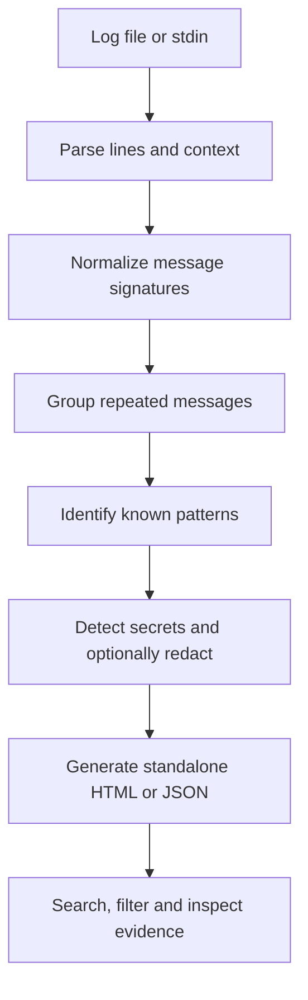

# Logloom

**Turn terminal chaos into a debugging report.**

Logloom is a local-first command-line tool that turns noisy terminal output, build logs, and test failures into searchable, standalone HTML reports. It groups repeated messages, preserves the original evidence, and helps you review possible secrets before sharing a report.

- **Local-first:** logs are analyzed on your machine; no AI API or hosted service is required.
- **Lightweight:** no third-party runtime dependencies.
- **Cross-platform:** designed for Windows and Linux.
- **Evidence-led:** findings retain source context. Pattern matches are clues, not guaranteed root causes.

## What it does

- Parses terminal output and recognizes selected severity labels and common failure patterns.
- Groups likely duplicates using normalized message signatures.
- Reduces clutter from repeated messages while preserving original line references.
- Generates a standalone HTML report with search and filtering.
- Detects selected secret patterns and can redact detected values in the report.
- Offers JSON output for scripting and automation.

## Quick start

Requires Python 3.9 or newer.

**The current GitHub repository stores the Python project inside the `logloom/` subdirectory.** Run the commands below from that directory.

```powershell
git clone https://github.com/Lidnas/Logloom.git
cd Logloom\logloom

# Install the CLI in editable mode
py -m pip install -e .

# Analyze a log file
logloom analyze examples\failed-build.log --output report.html

# Analyze piped output and redact detected secrets
Get-Content examples\failed-build.log | logloom analyze - --redact

# View all CLI options
logloom analyze --help
```

On Linux:

```bash
git clone https://github.com/Lidnas/Logloom.git
cd Logloom/logloom
python3 -m pip install -e .
logloom analyze examples/failed-build.log --output report.html
cat examples/failed-build.log | logloom analyze - --redact
logloom analyze --help
```

Open `report.html` in your browser. The report is a local HTML file; no account or network service is needed to inspect it.

## Example commands

Analyze a file:

```bash
logloom analyze build.log --output report.html
```

Analyze output from another command:

```bash
pytest 2>&1 | logloom analyze -
```

Create JSON output for another tool:

```bash
logloom analyze build.log --format json --output report.json
```

Redact detected secrets in an HTML report:

```bash
logloom analyze build.log --redact --output report.html
```

Useful options include:

| Option | Purpose |
|---|---|
| `--output FILE` | Choose the report path. |
| `--format html|json` | Select HTML or JSON output. |
| `--redact` | Redact values matching supported secret patterns in the report. |
| `--no-raw` | Omit the raw-output section from the HTML report. |
| `--min-severity LEVEL` | Set the minimum displayed severity. |
| `--fail-on never|warning|error` | Return a non-zero exit status when the chosen threshold is met. |
| `--title TEXT` | Set the report title. |
| `--quiet` | Suppress the CLI summary. |

Run `logloom analyze --help` for the complete list of supported arguments.

## How it works



Logloom is intended to help you find relevant evidence faster, not to decide the root cause for you. Similar messages can have different causes, and the first error is not always the underlying cause.

## Privacy and security

Logs can contain API keys, access tokens, internal hostnames, usernames, file paths, and other sensitive data.

- Log processing happens locally.
- Secret detection covers selected patterns only; it cannot guarantee that every sensitive value will be found.
- Without `--redact`, the generated report may contain original secret values.
- Redaction applies to detected patterns; it is not a guarantee that a report is safe to publish.
- Review the generated report before sharing it.
- Log content is untrusted input and should never be treated as executable instructions.

Use `--redact` when creating a report intended for review or sharing, and still inspect the result manually.

## Performance and tests

The current development snapshot has **158 automated tests passing**. Tests cover parsing, signature grouping, pattern detection, redaction, report generation, CLI behavior, and documentation consistency.

A development benchmark on a 100,000-line log reported approximately **3.6 seconds** across parsing, analysis, secret detection, and report rendering. Results vary with hardware, input characteristics, and report size; this is a reference measurement, not a performance guarantee.

To run the test suite from the project directory:

```bash
python -m unittest discover
```

## Project status

Logloom is an early-stage open-source developer tool. Pattern coverage and report behavior will continue to evolve as it is tested against more real-world logs.

Contributions that are especially useful:

- Small, sanitized log fixtures with expected findings.
- Parser improvements for build tools and test runners.
- Cross-platform bug reports.
- Security tests for HTML rendering and redaction.
- Documentation and usability improvements.

When reporting a bug, include the smallest sanitized input that reproduces it. Do not upload production logs, credentials, or private data to public issues.

## License

Released under the [MIT License](LICENSE).
