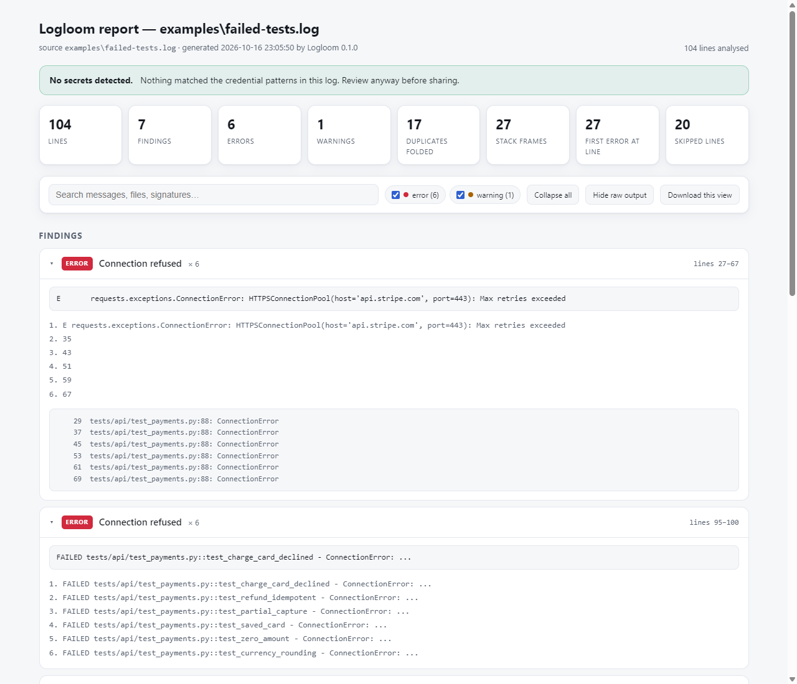
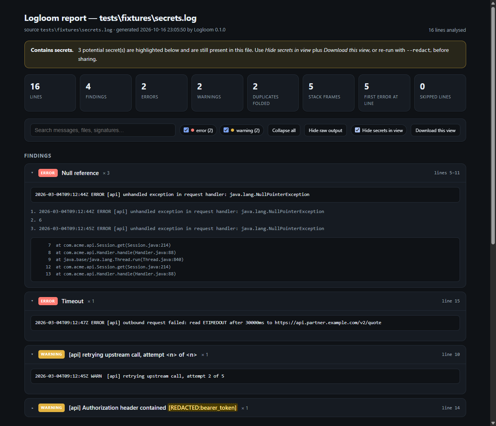
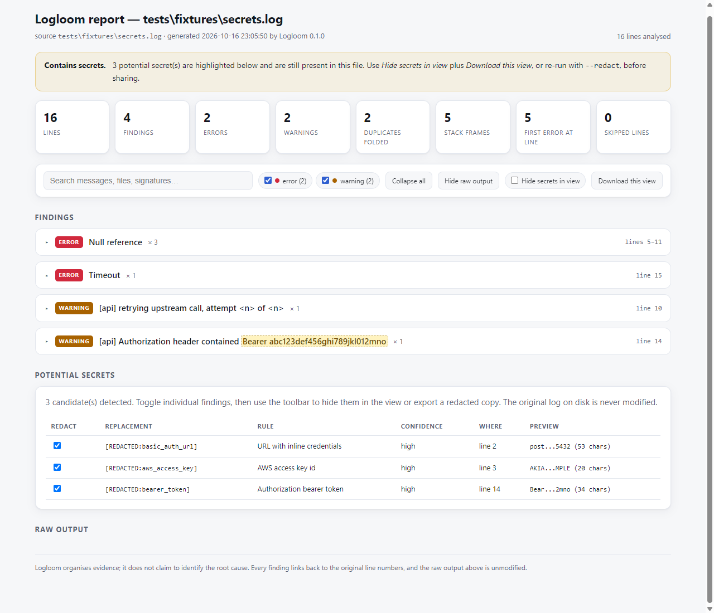

# Logloom

**Turn terminal chaos into a debugging report.**

Logloom is a local-first, cross-platform CLI that turns noisy build logs, test
failures and terminal output into a searchable, standalone HTML report. No
server, no account, no API key, no network calls.



```
2,000 lines in  ──▶  grouped findings + original line numbers + one HTML file
```

- **Local-first** — logs are processed on your machine and never uploaded.
- **No AI required** — deterministic analysis with transparent, inspectable heuristics.
- **Easy to share** — one self-contained HTML file that works offline.
- **Cross-platform** — tested on Windows and Linux, pure standard library.
- **Privacy-aware** — detects likely secrets and lets you review them before sharing.

## Quick start

```bash
python -m pip install logloom

# analyse a file
logloom analyze build.log

# choose where the report goes
logloom analyze build.log --output report.html

# analyse output from another command
pytest 2>&1 | logloom analyze -

# machine-readable output (goes to stdout, summary stays on stderr)
logloom analyze build.log --format json

# scrub likely secrets before sharing
logloom analyze build.log --redact --output share.html
```

No install? Clone and run it straight from the source tree:

```bash
git clone https://github.com/logloom/logloom
cd logloom
python -m logloom analyze examples/failed-tests.log
```

## What you get

Real pytest output — 104 lines — becomes 7 findings:


| Section | What it does |
| --- | --- |
| Stats | line counts, finding counts, duplicates folded, first error line |
| Findings | one card per signature: severity, label, count, first/last line, every occurrence, stack frames, file references |
| Potential secrets | every candidate with rule, confidence and preview, toggleable before export |
| Raw output | the complete original log, unmodified, with line numbers and severity markers |

The report follows your system's light or dark mode, needs no server, and works
with JavaScript disabled (search and filters are the only things you lose).



## How it works

1. **Parse** line by line: ANSI colours stripped, severity and timestamps
   detected, stack frames identified, low-information progress lines marked as
   noise.
2. **Group** repeated messages by a normalised signature, so
   `connection refused to 10.0.0.7:5432 after 3 attempts` and
   `...10.0.0.9:5432 after 7 attempts` become one finding with a count and every
   original line number.
3. **Coalesce** neighbouring failures that share a label, so one build failure
   reported five ways is one card, not five.
4. **Label** a finding when it matches a curated pattern. Anything unrecognised
   is still grouped, with the truncated message as its title — Logloom never
   invents an explanation.
5. **Flag** likely secrets and let you review them.
6. **Render** one standalone HTML file.

Logloom does **not** claim to find the root cause. It organises evidence so the
investigation is faster, and every finding points back at the original lines.

## Supported patterns

These are the curated heuristics in `logloom/signatures.py`. They are the only
thing that produces a label; everything else is grouped but titled with the
message itself. The first matching pattern wins, so specific patterns are listed
before general ones.

<!-- BEGIN GENERATED: patterns -->

| Label | Matches (examples) | Severity |
| --- | --- | --- |
| **Missing module** | ``ModuleNotFoundError`, `Cannot find module`` | error |
| **Missing file** | ``FileNotFoundError`, `ENOENT`, `file or directory not found`` | error |
| **Command not found** | ``command not found`, `is not recognized as an internal`` | error |
| **Permission denied** | ``EACCES`, `Access is denied`, `Operation not permitted`` | error |
| **Process crash** | ``Segmentation fault`, `core dumped`, `panic:`` | fatal |
| **Out of memory** | ``JavaScript heap out of memory`, `exit code 137`, `cannot allocate memory`` | fatal |
| **Disk full** | ``No space left on device`, `ENOSPC`` | fatal |
| **Port already in use** | ``Address already in use`, `EADDRINUSE`` | error |
| **Syntax error** | ``SyntaxError`, `unexpected token`, `parse error`` | error |
| **Link error** | ``undefined reference`, `use of undeclared crate`` | error |
| **Null reference** | ``NullPointerException`, `Cannot read property of null`, `NoneType`` | error |
| **Type mismatch** | ``TypeError`, `incompatible types`` | error |
| **Invalid value** | ``ValueError`, `ValidationError`, `invalid literal for`` | error |
| **Missing key** | ``KeyError`, `Key not found`` | error |
| **Out of range** | ``IndexError`, `out of bounds`` | error |
| **Missing attribute** | ``AttributeError`, `has no attribute`` | error |
| **Connection refused** | ``Connection refused`, `ECONNREFUSED`` | error |
| **Timeout** | ``ETIMEDOUT`, `deadline exceeded`, `Read timed out`` | error |
| **Connection reset** | ``ECONNRESET`, `BrokenPipe`` | error |
| **DNS failure** | ``getaddrinfo`, `Name or service not known`, `NXDOMAIN`` | error |
| **TLS or certificate** | ``certificate verify failed`, `self-signed certificate`` | error |
| **Authentication** | ``401`, `authentication failed`, `invalid credentials`` | error |
| **Rate limited** | ``429`, `Too Many Requests`, `rate limit`` | warning |
| **Not found** | ``404`, `Not Found`, `not found:`` | error |
| **Server error** | ``500`, `Internal Server Error`` | error |
| **Test failure** | ``AssertionError`, `assert 1 == 2`, `FAILED tests/api/x.py::test_y`` | error |
| **Test failure** | ``AssertionError`, `assert 1 == 2`, `FAILED tests/api/x.py::test_y`` | error |
| **Deprecation** | ``DeprecationWarning`, `has been deprecated`` | warning |
| **Build failed** | ``error: could not compile`, `ELIFECYCLE`, `BUILD FAILED`, `*** [Makefile:42]`` | error |
| **Registry error** | ``EAI_AGAIN`, `registry request to ... failed`` | error |
| **Unresolved reference** | ``could not resolve`, `cannot find value x in this scope`` | error |
| **Non-zero exit** | ``exit code 1`, `exited with 2`, `exit status 1`` | error |

<!-- END GENERATED: patterns -->

### Severity detection

Severity comes from the input, not from guessing:

- bracketed tags: `[ERROR]`, `[WARN ]`, `[FATAL]`
- a leading keyword: `ERROR:`, `Warning -`, `FATAL`
- glog lines: `E0910 10:22:42.220  3301 file.cc:99] message`
- pytest/unittest progress letters: `E   ModuleNotFoundError: ...`
- a curated pattern can raise a plain line to error/fatal (e.g. `Segmentation fault`)

## Secret detection



<!-- BEGIN GENERATED: secrets -->

| Rule | Detects | Default | Notes |
| --- | --- | --- | --- |
| `private_key` | PEM private key block | redact | high |
| `aws_access_key` | AWS access key id | redact | high |
| `aws_secret_key` | AWS secret access key | redact | high |
| `github_token` | GitHub personal access token | redact | high |
| `slack_token` | Slack token | redact | high |
| `google_api_key` | Google API key | redact | high |
| `stripe_key` | Stripe secret key | redact | high |
| `openai_key` | OpenAI style API key | redact | high |
| `jwt` | JSON web token | redact | high |
| `bearer_token` | Authorization bearer token | redact | high |
| `basic_auth_url` | URL with inline credentials | redact | high |
| `connection_string` | Database connection string with password | redact | high |
| `password_assignment` | Credential-looking assignment | redact | medium |
| `email` | Email address (often harmless, left for review) | review | low |

<!-- END GENERATED: secrets -->

### ⚠️ Read this before sharing a report

- **Without `--redact`, the report file contains the original log text,
  secrets included.** Secrets are *highlighted*, not removed. Sharing that file
  shares the secret.
- **With `--redact`, every detected secret is replaced** in the findings, the
  titles, the search index and the raw output. Nothing else is modified.
- The **Hide secrets in view** checkbox only changes what your browser displays.
  Use **Download this view** while it is checked to write a scrubbed copy.
- Detection is pattern based. It covers common credential shapes, not every
  encoding or secret format. Review the list before you share.
- Your original log file on disk is never modified.

Verify with a real file before you trust it:

```bash
logloom analyze debug.log --redact -o share.html
grep -c "AKIA" share.html    # expect 0
```

## Command line

```
usage: logloom analyze [-h] [-o OUTPUT] [--format {html,json}] [--redact]
                       [--no-raw] [--title TITLE]
                       [--min-severity {fatal,error,warning,info,debug,log}]
                       [--fail-on {never,warning,error}] [--stdout] [-q]
                       [path]
```

| Option | Meaning |
| --- | --- |
| `PATH` | log file, or `-` for stdin (default) |
| `-o`, `--output` | report file (default: `logloom-report.html` for html, **stdout** for json) |
| `--format` | report format: `html` (default) or `json` |
| `--redact` | replace detected secrets in the report |
| `--no-raw` | omit the raw output section |
| `--title` | report title |
| `--min-severity` | `warning` (default) hides info-level noise; `info`/`log` show everything |
| `--fail-on` | `never` (default), `warning` or `error`: exit non-zero when findings reach this severity |
| `--stdout` | write the report to stdout |
| `-q`, `--quiet` | suppress the stderr summary |

**Streams are strict on purpose.** stdin is only ever log input, stdout only
ever carries an explicitly requested report, and all diagnostics go to stderr.
That is what makes `make build 2>&1 | logloom analyze -` safe.

### Exit codes

| Code | Meaning |
| --- | --- |
| 0 | report written |
| 1 | `--fail-on` threshold reached |
| 2 | bad usage (argparse) |
| 3 | input could not be read, or the report could not be written |

## Examples

```bash
# CI: attach a report and fail the job when errors are present
logloom analyze build.log --fail-on error -o build-report.html

# inspect without writing a file
logloom analyze debug.log --format json \
  | python -c "import json,sys; print(json.load(sys.stdin)['summary'])"

# see everything, including informational lines
logloom analyze debug.log --min-severity info

# a smaller report to paste into an issue
logloom analyze debug.log --no-raw --redact -o share.html
```

Sample logs live in [`examples/`](examples) and [`tests/fixtures/`](tests/fixtures).
`examples/failed-tests.log` is a pytest run, `examples/failed-build.log`
deliberately chains failures from several different tools.
`tests/fixtures/secrets.log` demonstrates secret detection.

## Performance

Generated by `python bench.py` on one core of a laptop-class x86 machine:

```
case                lines    parse  analyze  detect  render    total   notes
-----------------------------------------------------------------------------
typical CI log      20000    0.07s    0.64s   0.40s   0.10s    1.21s   3 findings, 5.2 MB report
repetitive log      20000    0.12s    1.59s   0.44s   0.10s    2.25s   4 findings, 5.9 MB report
large log          100000    0.62s    3.56s   1.88s   0.48s    6.53s   3 findings, 25.7 MB report
```

**Methodology.** The benchmark generates deterministic synthetic logs from a
fixed seed (so runs are comparable across machines), times each pipeline stage
separately with `time.perf_counter`, and clears the memoisation caches before
every repetition so the numbers describe a cold run rather than a warm cache.
The best of three repetitions is reported as the least noisy estimator. Runs are
in-process after import; CLI startup is not included. Absolute numbers are
machine specific — the relative stage costs are the meaningful part.

Analysis is linear in the number of lines with a bounded number of regex passes
per line. The two optimisation passes are memoisation of `normalize`/`classify`
(`functools.lru_cache`), which collapses the many repeated messages in real
logs, and merging the heuristic patterns into a single alternation so
classification costs one scan instead of ~30.

A note on report size: the raw output section keeps every line, so a 100k line
log produces a ~25 MB HTML file. Use `--no-raw` if you want a small report.

## Limitations

- Findings are grouped by message signature. Logloom does not infer causality or
  dependencies between failures.
- Labels come from a curated pattern list. Unrecognised failures get a truncated
  message as their title rather than a guess.
- Coalescing merges same-label findings within a 25-line window. Two genuinely
  different failures of the same kind, reported close together, will share a card.
- Secret detection is pattern based and will have both false negatives and false
  positives. Emails are flagged but not redacted by default.
- Findings only cover warning severity and above by default; informational lines
  are counted but not listed.
- A very large log produces a very large report file (see above).

## Requirements

Python 3.9 or newer. No runtime dependencies. Tested on Windows and Linux with
Python 3.9, 3.11 and 3.13 in CI.

## Contributing

See [CONTRIBUTING.md](CONTRIBUTING.md). Real-world log fixtures are the most
useful contribution — see [docs/design.md](docs/design.md) for the heuristics
and the reasoning behind them.

## Status

Early development (v0.1.0). Bug reports, heuristic improvements and sanitised
real-world log samples are welcome.

## License

MIT — see [LICENSE](LICENSE).